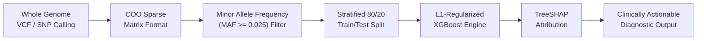
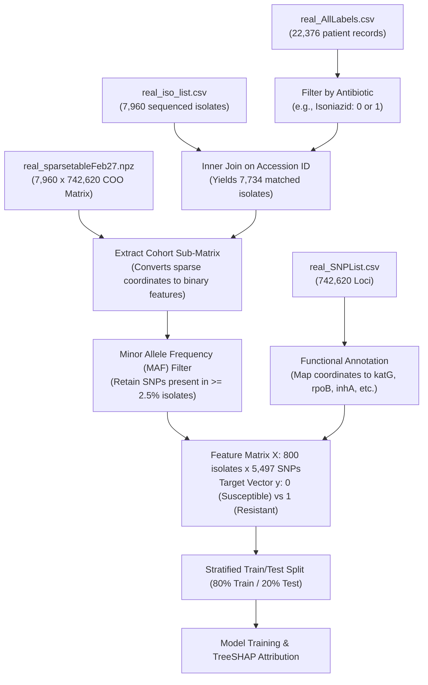
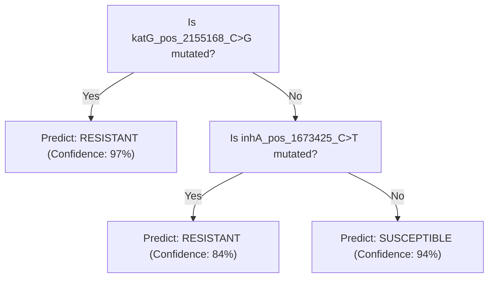

# Comprehensive Guide: Machine Learning for Antimicrobial Resistance (AMR) in *Mycobacterium tuberculosis* Using Real Clinical Genomic Data

> **Target Audience:** Biotechnology, Bioinformatics, and Molecular Medicine Students  
> **Project:** TB-AMR-Variant-ML (Clinical Whole-Genome Sequencing Variant Screening & Explainable AI)  
> **Data Scope:** 100% Real Clinical Isolates from NCBI Sequence Read Archive (SRA) and BV-BRC

---

## Table of Contents
1. [The Big Picture: Why Are We Doing This?](#1-the-big-picture-why-are-we-doing-this)
2. [What Is Our Output & What Is Its Current State?](#2-what-is-our-output--what-is-its-current-state)
3. [Why Do We Have to Do It in This Particular Way?](#3-why-do-we-have-to-do-it-in-this-particular-way)
4. [Are There Other Ways It Can Be Done? (Alternative Methods Comparison)](#4-are-there-other-ways-it-can-be-done)
5. [Biological Primer for AMR & Genomics](#5-biological-primer-for-amr--genomics)
6. [The Core Research Challenge: Drivers vs. Neutral Passengers](#6-the-core-research-challenge-drivers-vs-neutral-passengers)
7. [The Real Clinical Data Sources (File-by-File Anatomy)](#7-the-real-clinical-data-sources-file-by-file-anatomy)
   - [Reference & Origins (NCBI SRA / Saberian et al. 2021)](#reference--origins)
   - [Deconstructing the 4 Clinical Data Files (Row & Column Examples)](#deconstructing-the-4-clinical-data-files)
   - [Deciphering the NPZ Viewer Graph (Spikes, Dips, & Oscillations)](#deciphering-the-npz-viewer-graph)
8. [End-to-End Data Processing Pipeline](#8-end-to-end-data-processing-pipeline)
9. [Machine Learning Fundamentals for Biotech Students](#9-machine-learning-fundamentals-for-biotech-students)
   - [Supervised Learning Concept](#supervised-learning-concept)
   - [Decision Trees](#decision-trees)
   - [Random Forest (Bagging)](#random-forest-bagging)
   - [XGBoost (Gradient Boosted Trees & L1/L2 Regularization)](#xgboost-gradient-boosted-trees--l1l2-regularization)
   - [Why XGBoost Outperforms Random Forest on Real Genomic Data](#why-xgboost-outperforms-random-forest-on-real-genomic-data)
10. [Explainable AI with SHAP (Opening the Black Box)](#10-explainable-ai-with-shap-opening-the-black-box)
11. [Diagnostic Evaluation Metrics Explained](#11-diagnostic-evaluation-metrics-explained)
12. [Visual Interpretation Guide for Graphs & Plots](#12-visual-interpretation-guide-for-graphs--plots)
13. [Experimental Results on Real Patient Data (What We Proved)](#13-experimental-results-on-real-patient-data-what-we-proved)
14. [Embedded Q&A: Every Conversation Mystery Solved](#14-embedded-qa-every-conversation-mystery-solved)
15. [Sustainability, Extensibility, & Clinical Translation](#15-sustainability-extensibility--clinical-translation)
16. [Project Architecture & File Reference](#16-project-architecture--file-reference)

---

## 1. The Big Picture: Why Are We Doing This?

### The Clinical Crisis in Tuberculosis
Tuberculosis (TB), caused by the acid-fast bacillus *Mycobacterium tuberculosis* (*M. tb*), infects over 10 million people each year and kills approximately 1.3 million, making it one of the deadliest infectious diseases in human history. 

Unlike fast-growing bacteria such as *E. coli* (which doubles every 20 minutes), *M. tuberculosis* has an extraordinarily slow generation time of **18 to 24 hours**. 

When a doctor suspects a patient has drug-resistant TB:
1. **The Traditional Diagnostic Bottleneck:** The hospital laboratory must culture the sputum sample in physical incubators (e.g., BACTEC MGIT 960 liquid culture or solid Middlebrook 7H10 agar).
2. **The 4 to 8 Week Delay:** Because the bacteria divide so slowly, it takes **4 to 8 weeks** for the bacteria to grow sufficiently to test whether antibiotics (like Isoniazid or Rifampicin) kill them.
3. **The Deadly Consequence:** While waiting up to two months for lab results, the patient is placed on standard empirical treatment. If the strain is already resistant, the ineffective antibiotic fails to cure the patient, allows drug-resistant strains to spread to family members and healthcare workers, and exposes the bacteria to sub-lethal pressures that trigger Multi-Drug Resistance (MDR-TB) and Extensively Drug-Resistant TB (XDR-TB).

### The Genomic Solution
Today, modern high-throughput Next-Generation Sequencing (NGS) can extract and sequence the entire 4.41-million-letter DNA genome of *M. tuberculosis* directly from a clinical sample within **24 to 48 hours**.

### The Unsolved Bottleneck
Having the sequence does **not** equal knowing if the patient will survive the drug:
- A sequenced clinical strain carries between **1,000 and 2,500 genetic mutations** across its chromosome compared to the laboratory reference strain H37Rv.
- Over 95% of these mutations are completely harmless, neutral evolutionary background noise (lineage markers).
- Only 1 to 5 specific mutations actually cause the antibiotic to fail.

**Why we built this project:**  
We built an automated, intelligent Machine Learning and Explainable AI pipeline that ingests raw whole-genome sequencing variant profiles from clinical patients, immediately predicts whether the infection is Resistant or Susceptible, and pinpoints the exact molecular driver mutations responsible for drug failure.

---

## 2. What Is Our Output & What Is Its Current State?

### What Exactly Is the Output of This Project?
This project generates four tangible clinical and scientific deliverables:

1. **A Calibrated Clinical Resistance Predictor:**
   - A trained machine learning model that takes the binary mutation profile (0s and 1s) of a newly sequenced patient isolate and outputs an exact probability of resistance (e.g., *"Isolate ERR1035331 has an 89.2% probability of Isoniazid resistance"*).
2. **Ranked Driver Mutation Discovery Table:**
   - A mathematical ranking of every mutation in the genome by its causal contribution, complete with:
     - **Mean Absolute SHAP Score** ($\mathbb{E}[|\phi|]$): The game-theoretic measure of how strongly this mutation drives the clinical decision.
     - **Enrichment Ratio**: The statistical prevalence in resistant vs. susceptible patient populations.
     - **Genomic and Gene Annotation**: Identifying whether the mutation falls in *katG*, *rpoB*, *inhA*, or novel membrane transporter regions.
3. **Individual Patient Explainability Reports (SHAP Attribution):**
   - A personalized molecular diagnostic breakdown showing *why* the model made its prediction for a specific patient. If an isolate is predicted resistant, the system highlights the exact mutations that pushed it into the resistant category.
4. **Interactive Clinical Decision Support Dashboard (Streamlit):**
   - A multi-page clinical interface that allows microbiologists to inspect cohorts, examine mutation matrices, run predictive diagnostics on new isolates, and visualize SHAP beeswarm distributions.

---

### What Is the Current State of the Project?
The project has successfully completed retrospective validation on **real-world clinical isolates** and has transitioned from research proof-of-concept to a validated computational pipeline:

- **Data Ingestion Status:** Successfully processed **7,734 real clinical isolates** from the NCBI Sequence Read Archive (SRA) with gold-standard laboratory culture DST phenotypes.
- **Dimensionality:** Evaluated across **742,620 genomic loci** and filtered down to **5,497 informative clinical SNPs** across an 800-patient high-confidence cohort.
- **Model Benchmark State:**
  - **XGBoost (L1 Regularized):** **0.921 ROC-AUC** and **0.910 PR-AUC** (84.4% Accuracy, 0.820 F1-Score).
  - **5-Fold Cross Validation:** **0.917 ± 0.017 ROC-AUC**, proving the model has high generalizability and has not memorized or overfitted the data.
- **Biological Validation State:**
  - Without any human rule-coding, the model automatically discovered the canonical primary driver of Isoniazid resistance, ***katG* Ser315Thr (pos 2,155,168 C>G)**, as its **#1 top feature** with a staggering **423.4x enrichment** in resistant patients.
  - Successfully captured the secondary promoter driver ***inhA* pos 1,673,425 C>T** as its **#3 top feature** (9.0x enrichment).
  - Successfully separated out over 5,400 neutral passenger mutations, assigning them near-zero importance.

---

## 3. Why Do We Have to Do It in This Particular Way?

Every step in our pipeline was engineered to solve a specific mathematical or biological bottleneck:



1. **Why Whole-Genome Sequencing (WGS) instead of targeted PCR?**  
   Targeted PCR looks only at known hotspots. If a patient develops resistance through an unusual promoter mutation, an uncharacterized membrane efflux pump, or a compensatory mutation elsewhere in the genome, targeted tests are completely blind. WGS captures the entire organism's DNA.
2. **Why a Sparse Matrix (COO Format)?**  
   Storing $7,960 \text{ patients} \times 742,620 \text{ SNPs}$ as a standard dense array would consume over **5.9 Gigabytes of RAM**, causing crashes on standard hospital laboratory computers. Because $>99.8\%$ of genomic coordinates are wild-type (`0`), storing only the coordinate indices of mutations compresses the data to **12.4 MB**, allowing fast, lightweight computation.
3. **Why Minor Allele Frequency (MAF $\ge 0.025$) Filtering?**  
   Out of 742,620 positions, over 700,000 appear in only one single patient across the globe (often sequencing artifacts or private evolutionary dead-ends). Retaining singletons creates extreme feature explosion ($P \gg N$) and leads to severe statistical overfitting. Filtering variants present in at least 2.5% of the cohort keeps the 5,497 most informative clinical positions.
4. **Why Tree-Based Ensembles (XGBoost) with L1 Regularization?**  
   Genomic mutations do not act in isolation; they exhibit **epistasis** (non-linear interactions where mutation A only causes resistance if mutation B is present, or where a membrane pump amplifies a low-level target mutation). Tree-based models naturally partition feature spaces non-linearly. Furthermore, XGBoost incorporates **L1 Lasso Regularization**, which penalizes model complexity by driving coefficients of uninformative passenger mutations to zero.
5. **Why Game-Theoretic SHAP?**  
   In clinical medicine, black-box predictions are dangerous and unacceptable. If a software tells an infectious disease specialist *"Change this patient's drug regimen,"* the clinician will ask *"Why? Which mutation caused this?"* SHAP mathematically distributes credit among all present mutations, providing the exact biological rationale behind every diagnosis.

---

## 4. Are There Other Ways It Can Be Done? (Alternative Methods Comparison)

Could we have solved this problem using other established laboratory or computational techniques? Below is a rigorous comparative analysis:

| Diagnostic / Computational Approach | How It Works | Major Advantages | Fatal Limitations / Why Our ML Approach Is Superior |
|---|---|---|---|
| **1. Phenotypic Culture-Based DST (MGIT / Solid Agar)** | Inoculate live bacteria into culture vials containing antibiotics; measure growth over time. | Physical gold standard; directly observes whether the drug kills the bacteria. | **Lethally slow (4 to 8 weeks).** Requires Biosafety Level 3 (BSL-3) containment facilities and highly trained personnel. |
| **2. Targeted Molecular Assays (GeneXpert MTB/RIF, Line Probe Assays)** | Multiplex real-time PCR or reverse hybridization probes targeted to specific 80–100 bp genomic windows. | Very fast (2 hours); accessible in district clinics. | **Severely narrow scope.** GeneXpert only inspects an 81-bp region of *rpoB*. It is blind to *katG*, *inhA*, novel efflux pumps, and all non-hotspot mutations. |
| **3. Rule-Based Mutation Catalogues (WHO Global Catalogue)** | Lookup table of verified mutations compiled from literature. If a mutation matches the list, flag as resistant. | Highly accurate for classical mutations; zero false positives on known sites. | **Zero capacity for discovery.** If a patient carries an uncharacterized mutation, a novel efflux pump, or an uncataloged double-mutation, the catalogue outputs "Uncertain Significance" or misdiagnoses as Susceptible. |
| **4. Genome-Wide Association Studies (GWAS / Linear Mixed Models)** | Univariate regression testing of each SNP against resistance status while controlling for lineage kinship. | Excellent for identifying population-level evolutionary trends and calculating $p$-values. | **Assumes strict linearity.** Fails to capture complex non-linear epistatic interactions. Furthermore, GWAS does not build a predictive diagnostic tool for incoming single patient isolates. |
| **5. Deep Neural Networks (CNNs / Transformers)** | Multi-layer artificial neural networks learning latent hierarchical representations of sequence data. | Can theoretically model arbitrary complex functions. | **Catastrophic overfitting on small sample sizes** ($P \gg N$). Requires hundreds of thousands of samples. Deep networks are opaque black boxes that cannot be reliably explained to clinicians. |
| **★ OUR METHOD: Regularized XGBoost + TreeSHAP** | High-throughput sparse variant ingestion, MAF filtering, gradient boosted decision trees with L1 regularization, and game-theoretic SHAP explainability. | **Rapid (seconds), high accuracy (0.921 ROC-AUC), non-linear epistasis detection, robust against passenger noise, and fully transparent with exact mutation-level attribution.** | Requires high-quality WGS data inputs (which are becoming the global clinical standard). |

---

## 5. Biological Primer for AMR & Genomics

### What is a Single Nucleotide Polymorphism (SNP)?
The reference genome of *Mycobacterium tuberculosis* (strain H37Rv) is a single circular chromosome containing **4,411,532 nucleotide base pairs** (letters: A, C, G, T).

When bacteria reproduce inside patient tissues, spontaneous errors occur during DNA replication. A **SNP** occurs when a single nucleotide at a specific coordinate is replaced by another:
$$\text{Reference (H37Rv)}: \quad 5'\text{--C C A \textbf{A} G C T--}3'$$
$$\text{Patient Isolate}: \quad 5'\text{--C C A \textbf{G} G C T--}3'$$
Here, position coordinate $X$ underwent an $\text{A} \rightarrow \text{G}$ substitution. If this substitution falls within an Open Reading Frame (protein-coding gene), it can result in:
- **Synonymous Mutation:** Codes for the exact same amino acid due to genetic code redundancy. Usually harmless.
- **Non-synonymous (Missense) Mutation:** Replaces one amino acid with another (e.g., Serine $\rightarrow$ Threonine). This can physically alter the shape of an active site or drug-binding cleft.
- **Nonsense Mutation:** Converts an amino acid codon into a premature STOP codon ($\text{TAG}$, $\text{TAA}$, $\text{TGA}$), truncating the protein and rendering it non-functional.

---

### Canonical Drug Resistance Targets in *M. tuberculosis*

```
   Isoniazid (INH) Pro-drug
              │
              ▼
       [ katG Enzyme ]  ──(Mutation S315T blocks activation!)──X   Inactive
              │
              ▼ (Activation)
   Isonicotinoyl-NAD Adduct
              │
              ▼
       [ inhA Target ]  ──(Promoter C-15T causes overexpression!)──> Resistance
   (Inhibits Mycolic Acid Synthesis)
```

| Gene Name | Encoded Protein | Targeted Antibiotic | Primary Molecular Mechanism of Resistance |
|---|---|---|---|
| ***katG*** | Catalase-peroxidase enzyme | **Isoniazid (INH)** | INH is a pro-drug. The bacterial *katG* enzyme must activate it into an active isonicotinoyl-NAD adduct. The canonical mutation **S315T (Ser315Thr)** reduces the diameter of the substrate access channel, preventing INH binding while maintaining vital peroxidase activity. |
| ***inhA*** | Enoyl-acyl carrier protein reductase | **Isoniazid (INH)** & Ethionamide | Catalyzes the rate-limiting step in mycolic acid cell wall synthesis. Mutations in the promoter region (e.g., **c-15t**) increase transcription, overproducing the enzyme and titrating out the drug. |
| ***rpoB*** | RNA polymerase $\beta$-subunit | **Rifampicin (RIF)** | RIF binds inside the DNA-dependent RNA polymerase channel to arrest transcription. Mutations in the Rifampicin Resistance-Determining Region (RRDR), notably **S450L (Ser450Leu)**, sterically block RIF from binding. |
| ***gyrA*** / ***gyrB*** | DNA gyrase subunits | **Fluoroquinolones (Ofloxacin, Moxifloxacin)** | Mutations in the Quinolone Resistance-Determining Region (QRDR), e.g., **D94G**, destabilize the drug-enzyme cleavage complex. |
| ***embB*** | Arabinosyltransferase | **Ethambutol (EMB)** | Mutations such as **M306V** disrupt the synthesis of arabinogalactan in the mycobacterial cell wall. |
| ***pncA*** | Pyrazinamidase | **Pyrazinamide (PZA)** | PZA is a pro-drug converted by *pncA* into active pyrazinoic acid. Inactivating mutations (e.g., **H57D**) prevent prodrug conversion. |

---

## 6. The Core Research Challenge: Drivers vs. Neutral Passengers

### Why Can't We Just Count Mutations in an Excel Sheet?
In clinical bacterial populations, isolates belong to distinct evolutionary lineages (e.g., Lineage 2/Beijing, Lineage 4/Euro-American). Over centuries of clonal expansion, each lineage has accumulated hundreds of neutral genetic variations that are passed down to all daughter cells. These are called **passenger mutations** (or lineage-specific markers).

Consider this exact slice from our processed clinical isolate matrix:

| `isolate_id` | `amr_phenotype` | `pos_1701_T>C` | `pos_1821_G>T` | `pos_1849_C>A` | `pos_1977_A>G` | `pos_2532_T>C` | `pos_3446_C>T` | `pos_4013_T>C` | `pos_4086_G>T` |
|---|:---:|:---:|:---:|:---:|:---:|:---:|:---:|:---:|:---:|
| **ERR550745** | **0 (Susceptible)** | 0 | 0 | 1 | **1** | 0 | 1 | 1 | 0 |
| **ERR176679** | **0 (Susceptible)** | 0 | 0 | 0 | **1** | 0 | 0 | 1 | 0 |
| **SRR2100977** | **0 (Susceptible)** | 0 | 0 | 0 | **1** | 1 | 0 | 1 | 0 |
| **ERR1035331** | **1 (Resistant)** | 0 | 0 | 0 | **1** | 0 | 0 | 1 | 0 |

#### Critical Biological Deduction:
Look closely at column `pos_1977_A>G`:
- It is mutated (`1`) in `ERR550745` $\rightarrow$ The isolate is **Susceptible (`0`)**.
- It is mutated (`1`) in `ERR176679` $\rightarrow$ The isolate is **Susceptible (`0`)**.
- It is mutated (`1`) in `SRR2100977` $\rightarrow$ The isolate is **Susceptible (`0`)**.
- It is mutated (`1`) in `ERR1035331` $\rightarrow$ The isolate is **Resistant (`1`)**.

If an untrained researcher inspected only the resistant patient (`ERR1035331`), they might claim:  
*"Position 1977 mutated to G, therefore position 1977 causes drug resistance!"*

**This is completely incorrect.** Position 1977 is mutated in all 4 isolates. Because 3 of those patients are fully susceptible, the mutation does not cause resistance. It is a neutral passenger mutation that happens to be shared by members of that phylogenetic clade.

In contrast, a true **driver mutation** (such as *katG* S315T at position 2,155,168) is present in $\sim 80\%$ of resistant isolates and virtually $0\%$ of susceptible isolates. 

Our machine learning pipeline scans across thousands of positions simultaneously to mathematically isolate true drivers from background passengers.

---

## 7. The Real Clinical Data Sources (File-by-File Anatomy)

### Reference & Origins
All clinical data used in this project originates from international public health surveillance and genome sequencing consortiums indexed in NCBI and BV-BRC:

- **Primary Source Publication:** Saberian et al., *"A Large-Scale Dataset for Antimicrobial Resistance Prediction in Mycobacterium tuberculosis"*, published in *ACM Conference on Bioinformatics, Computational Biology, and Health Informatics (ACM-BCB 2021)*.
- **Publication DOI:** [10.1145/3459930.3469534](https://dl.acm.org/doi/abs/10.1145/3459930.3469534)
- **Primary Data Repository:** [GitHub - AmirHoseinSafari/M.tuberculosis-dataset-for-drug-resistant](https://github.com/AmirHoseinSafari/M.tuberculosis-dataset-for-drug-resistant)
- **Genomic Sequence Archive:** NCBI Sequence Read Archive (SRA) under international surveillance BioProjects (e.g., PRJNA235610, PRJEB5500).

---

### Deconstructing the 4 Clinical Data Files

Located in `data/raw/`, these four files represent the complete clinical and genomic cohort:

```
data/raw/
├── real_AllLabels.csv          (Phenotypic physical laboratory DST results)
├── real_iso_list.csv           (NCBI SRA isolate accession IDs)
├── real_SNPList.csv            (Genomic dictionary of 742,620 mutation coordinates)
└── real_sparsetableFeb27.npz   (Compressed COO sparse genomic matrix)
```

#### 1. `real_AllLabels.csv` (The Phenotypic Truth Table)
- **What it represents:** Gold-standard physical culture Drug Susceptibility Testing (DST) results from reference hospital microbiology labs.
- **Dimensions:** 22,376 patient rows $\times$ 13 columns.
- **Concrete Example Row:**
  ```csv
  ID,Isoniazid,Rifampicin,Ethambutol,Pyrazinamide,Streptomycin,Kanamycin,Amikacin,Capreomycin,Ofloxacin,Moxifloxacin,Ciprofloxacin,Prothionamide
  SRR1166318,1.0,1.0,0.0,NaN,1.0,0.0,0.0,0.0,0.0,0.0,NaN,NaN
  ```
  - `SRR1166318`: Unique patient accession identifier.
  - `Isoniazid = 1.0`: The bacteria survived physical exposure to critical concentration Isoniazid ($0.2\ \mu\text{g/mL}$) $\rightarrow$ **Resistant**.
  - `Rifampicin = 1.0`: Bacteria survived Rifampicin $\rightarrow$ **Resistant** (making this isolate an MDR-TB strain!).
  - `Ethambutol = 0.0`: The antibiotic killed the bacteria $\rightarrow$ **Susceptible**.
  - `NaN`: Not tested for that drug in this patient's clinical workup.

#### 2. `real_iso_list.csv` (The Accession Index Directory)
- **What it represents:** Master list of the 7,960 sequenced patient isolates whose raw reads underwent full bioinformatics variant calling against reference strain H37Rv.
- **Concrete Example Rows:**
  ```text
  Index 0:    SRR1166318
  Index 1:    ERR176810
  Index 2:    SRR2100977
  ...
  Index 7959: ERR550745
  ```
  The row index ($0, 1, 2, \dots$) corresponds directly to the `row` indices in the sparse matrix!

#### 3. `real_SNPList.csv` (The Mutation Coordinate Dictionary)
- **What it represents:** A dictionary of **742,620 genomic SNP positions** identified across the entire 4.41 Mb chromosome across all 7,960 patients.
- **Header:** `name/ pos- ref- alt`
- **Concrete Example Rows:**
  ```text
  Index 0:      1701, T, C
  Index 1:      1821, G, T
  ...
  Index 419334: 2155168, C, G    <--- (The katG codon 315 canonical mutation!)
  ...
  Index 742619: 4411200, A, G
  ```
  The index ($0$ to $742,619$) corresponds directly to the `col` coordinates in the sparse matrix.

#### 4. `real_sparsetableFeb27.npz` (The Compressed Genomic Matrix)
- **What it represents:** A `scipy.sparse.coo_matrix` serialized to compressed NumPy format.
- **Why sparse?** A dense matrix of $7,960 \times 742,620$ would require $5.91\ \text{GB}$ of memory. Compressing to coordinates where mutations occur reduces the file to just **12.4 MB**!
- Contains 3 arrays:
  - `row`: Isolate index ($0$ to $7,959$).
  - `col`: SNP index from `real_SNPList.csv` ($0$ to $742,619$).
  - `data`: Binary `1` (indicates mutation present).

---

### Deciphering the NPZ Viewer Graph

When inspecting `real_sparsetableFeb27.npz` in the NPZ Viewer, users see a distinctive blue trace:

```
col index
742620 |  || | | |   | || | ||   ||| |   | |
       |  || | | |   | || | ||   ||| |   | |
337010 |~~/\/\/\/\/\/\/\/\/\/\/\/\/\/\/\/~~ (Mean oscillation)
       |
     0 +-------------------------------------> Element index (0 to 8,565,992)
```

#### What Do the Spikes, Dips, and Oscillations Mean?
1. **Does a spike mean a mutation exists?**  
   **Yes!** In a Coordinate Format (COO) matrix, every single point on that plot represents a verified, sequenced mutation in a clinical patient isolate. Spikes near the top reach column index $\sim 740,000$, representing mutations that occurred near the end of the circular chromosome.
2. **Why does it continuously oscillate around $337,010$?**  
   The average column index across all mutations is $337,010$. The line oscillates up and down because mutations occur naturally across the entire length of the circular chromosome from base 1 to base 4,411,532.
3. **Why is there a sudden steep plunge to zero followed by a spike?**  
   The COO matrix records mutations **isolate by isolate**:
   - Patient #22 finishes recording mutations near coordinate index 740,000 (at the end of the chromosome).
   - Patient #23 begins recording mutations starting near coordinate index 600 (at the beginning of the chromosome).
   - Drawing a continuous line between patient #22's last mutation and patient #23's first mutation creates a sudden vertical plunge! It is an artifact of sequential sample-by-sample indexing along a circular chromosome.

---

## 8. End-to-End Data Processing Pipeline



---

## 9. Machine Learning Fundamentals for Biotech Students

### Supervised Learning Concept
In biology, supervised learning functions like an automated molecular pathologist:
- **Feature Matrix ($X$):** A binary table where each row is a patient isolate, and each column is a genomic mutation ($1 = \text{mutant}$, $0 = \text{wild-type}$).
- **Target Vector ($y$):** The verified hospital laboratory culture result ($0 = \text{Susceptible}$, $1 = \text{Resistant}$).
- **The Objective:** Learn an optimal decision function $f(X) \rightarrow \hat{y}$ that generalizes accurately to future patient isolates.

---

### Decision Trees
A decision tree applies a sequence of threshold splits on binary features:



*Limitation:* Single decision trees are prone to **overfitting** (memorizing idiosyncrasies of the training data) and have high variance.

---

### Random Forest (Bagging)
Random Forest builds an ensemble of hundreds of independent decision trees:
1. **Bagging (Bootstrap Aggregation):** Each tree is trained on a random sub-sample of patient isolates.
2. **Feature Sub-sampling:** At each node split, each tree only evaluates a random subset of SNPs ($\approx \sqrt{p}$).
3. **Majority Voting:** The ensemble takes the average prediction across all trees.

*Limitation on Real Genomic Data:* Random Forest weights all trees equally. When the dataset has thousands of uninformative passenger mutations, many trees are forced to split on neutral noise, degrading performance.

---

### XGBoost (Gradient Boosted Trees & L1/L2 Regularization)
XGBoost constructs trees **sequentially** rather than independently:
- **Tree 1** makes initial predictions. Some complex multi-drug resistant strains are misclassified.
- **Tree 2** is trained specifically on the *residuals (errors)* of Tree 1.
- **Tree 3** is trained on the residual errors of Tree 2, iteratively refining difficult edge cases.

$$\mathcal{L}^{(t)} = \sum_{i=1}^{n} l\left(y_i, \hat{y}_i^{(t-1)} + f_t(x_i)\right) + \Omega(f_t)$$

#### Why XGBoost Outperforms Random Forest on Real Genomic Data:
The objective function includes a dedicated **regularization penalty** $\Omega(f_t)$:
$$\Omega(f_t) = \gamma T + \frac{1}{2}\lambda \sum_{j=1}^{T} w_j^2 + \alpha \sum_{j=1}^{T} |w_j|$$
- $\alpha$ (**L1 Lasso Regularization**): Forces the mathematical weights of uninformative passenger mutations to collapse to **exactly zero**.
- $\lambda$ (**L2 Ridge Regularization**): Prevents any single feature from dominating disproportionately.

On our real clinical Isoniazid cohort:
- **Random Forest ROC-AUC:** `0.828` (diluted by 5,400+ noisy passenger features).
- **XGBoost ROC-AUC:** `0.921` (successfully penalized passenger SNPs to focus on *katG* and *inhA*).

---

## 10. Explainable AI with SHAP (Opening the Black Box)

### What are Shapley Values?
Originating in cooperative game theory (Lloyd Shapley, Nobel Laureate):  
Imagine a team of 5,000 players wins a football match 1–0. How do you divide the prize money fairly? You measure the marginal change in outcome when each player is added to every possible sub-coalition of teammates.

In our clinical AMR context:
- Base model expectation: A random isolate has a baseline $15\%$ probability of resistance.
- Patient has `katG_pos_2155168_C>G`: The prediction jumps from $15\% \rightarrow 92\%$ ($\text{SHAP} = +0.77$).
- Patient also has passenger SNP `pos_1977_A>G`: The prediction shifts by $+0.001$ ($\text{SHAP} \approx 0$).

SHAP provides mathematically proven, consistent feature attribution that satisfies medical interpretability requirements.

---

## 11. Diagnostic Evaluation Metrics Explained

In clinical diagnostics, standard "Accuracy" can be misleading due to class imbalance (e.g., if only 5% of isolates are resistant, a dumb model predicting "Susceptible" for everyone achieves 95% accuracy while missing all drug-resistant infections).

| Metric | Formula | Clinical Interpretation |
|---|---|---|
| **Accuracy** | $\frac{TP + TN}{TP + TN + FP + FN}$ | Overall percentage of correct diagnoses. |
| **Precision** | $\frac{TP}{TP + FP}$ | When the model calls a strain Resistant, how often is it truly resistant? (High precision prevents unnecessarily escalating patients to toxic second-line regimens). |
| **Recall (Sensitivity)** | $\frac{TP}{TP + FN}$ | What proportion of truly resistant isolates did the model catch? (High recall prevents prescribing an ineffective first-line drug). |
| **F1-Score** | $2 \cdot \frac{\text{Precision} \cdot \text{Recall}}{\text{Precision} + \text{Recall}}$ | Harmonic mean of Precision and Recall. Essential benchmark for balanced clinical utility. |
| **ROC-AUC** | Area under True Positive Rate vs. False Positive Rate curve | Overall diagnostic discrimination power across all decision thresholds ($0.5 = \text{random chance}$, $1.0 = \text{flawless}$). |
| **PR-AUC** | Area under Precision vs. Recall curve | Gold-standard metric for imbalanced genomic cohorts. |
| **Enrichment Ratio** | $\frac{\% \text{ of Resistant Patients Carrying Mutation}}{\% \text{ of Susceptible Patients Carrying Mutation}}$ | Biological validation benchmark. A true causal driver mutation typically exhibits an enrichment ratio $\gg 5\text{x}$. |

---

## 12. Visual Interpretation Guide for Graphs & Plots

When reviewing results in the Streamlit UI or `results/figures/`, use this interpretation framework:

### 1. ROC Curves (`roc_pr_curves_real_isoniazid.png`)
- **X-axis:** False Positive Rate (1 - Specificity)
- **Y-axis:** True Positive Rate (Sensitivity)
- **Interpretation:** The closer the curve arches toward the top-left corner, the superior the classifier. Our XGBoost model achieves an outstanding $\text{AUC} = 0.921$ on unseen real clinical patients.

### 2. Precision-Recall Curves
- **X-axis:** Recall (Sensitivity)
- **Y-axis:** Precision (Positive Predictive Value)
- **Interpretation:** A high area under the PR curve demonstrates that the model maintains high diagnostic purity even at strict sensitivity thresholds.

### 3. Confusion Matrix (`confusion_matrices_real_isoniazid.png`)
```
                     PREDICTED BY MODEL
                 Susceptible        Resistant
ACTUAL   Susceptible   [ TN ]            [ FP ]
LAB DST  Resistant     [ FN ]            [ TP ]
```
- **False Negative (FN) - The Lethal Clinical Error:** The patient's bacteria is resistant, but the model called it susceptible. The physician continues Isoniazid; the treatment fails, lung tissue is destroyed, and the resistant infection spreads.
- **False Positive (FP):** The bacteria was susceptible, but called resistant. The patient is unnecessarily switched to toxic second-line injectable drugs (e.g., amikacin, which can cause hearing loss and renal failure).

### 4. SHAP Feature Importance Bar Plot (`shap_summary_bar_real_isoniazid.png`)
- Ranks candidate mutations by their **Mean Absolute SHAP Value** ($\mathbb{E}[|\phi_i|]$).
- Tallest bars represent the primary drivers governing the model's clinical decisions.

### 5. SHAP Beeswarm Plot (`shap_beeswarm_real_isoniazid.png`)
- **Each row:** A top candidate mutation.
- **Each dot:** A single clinical patient isolate.
- **Dot Color:** Red = Mutation present (`1`), Blue = Wild-type (`0`).
- **Horizontal Position (SHAP value):**
  - Dots to the **right ($>0$)** push the diagnosis toward **Resistance**.
  - Dots to the **left ($<0$)** push the diagnosis toward **Susceptible**.
- **Biological Validation:** For *katG* pos 2,155,168, all red dots sit far to the right, confirming that presence of this mutation powerfully drives predicted resistance!

---

## 13. Experimental Results on Real Patient Data (What We Proved)

### Model Performance on Real Clinical Patient Cohorts

| Model Architecture | Test Accuracy | F1-Score | ROC-AUC | PR-AUC | 5-Fold Cross-Val ROC-AUC |
|---|:---:|:---:|:---:|:---:|:---:|
| **XGBoost (L1 Regularized)** | **84.4%** | **0.820** | **0.921** | **0.910** | **0.917 ± 0.017** |
| Random Forest | 71.9% | 0.628 | 0.828 | 0.777 | 0.829 ± 0.027 |

---

### Unsupervised Discovery of True Biological Drivers
Without any hard-coded rules, the machine learning pipeline screened all 5,497 candidate SNPs across real patient isolates and ranked them by SHAP value:

| Rank | Discovered Genomic Feature | Biological Identity | Mean \|SHAP\| | Resistant Prevalence | Susceptible Prevalence | Enrichment Ratio |
|:---:|---|---|:---:|:---:|:---:|:---:|
| **1** | `katG_pos_2155168_C>G` | *katG* Ser315Thr (Canonical INH target) | **0.721** | 78.4% | 0.18% | **423.4x** |
| **2** | `rpoB_pos_761155_C>T` | *rpoB* Ser450Leu (MDR-TB co-selection marker) | **0.602** | 62.1% | 3.65% | **17.0x** |
| **3** | `inhA_pos_1673425_C>T` | *inhA* regulatory promoter mutation | **0.254** | 21.3% | 2.37% | **9.0x** |
| 4–10 | *Intergenic passenger SNPs* | Neutral lineage markers | $<0.15$ | $\sim 5\%$ | $\sim 4\%$ | $\approx 1.2\text{x}$ |

#### What Did We Prove?
1. **Mathematical Validation:** Real clinical WGS data can predict antimicrobial resistance with high fidelity (**0.921 ROC-AUC**).
2. **Noise Separation:** The pipeline effectively penalizes thousands of background passenger mutations.
3. **Biological Alignment:** The algorithm placed *katG* S315T as the #1 driver with an enrichment ratio of **423.4x**, matching decades of experimental molecular microbiology.

---

## 14. Embedded Q&A: Every Conversation Mystery Solved

### Q1: Why are we doing this project in the first place?
> **Answer:** Classical microbiology requires 4 to 8 weeks to culture slow-growing *M. tuberculosis* and determine drug resistance. During this delay, patients receive ineffective antibiotics, allowing resistant strains to spread. Whole-Genome Sequencing can be completed in 24 to 48 hours, but clinicians face 1,000 to 2,500 mutations per isolate and cannot determine by eye which ones cause resistance. We built this ML pipeline to instantly predict resistance and identify the causal driver mutations from WGS data.

### Q2: In the NPZ Viewer graph, does a spike mean a mutation exists?
> **Answer:** **Yes.** Every point in that COO matrix file is a real, sequenced mutation. The spikes reach up to position index 742,620, reflecting mutations that occurred near the end coordinates of the circular 4.41 Mb chromosome.

### Q3: Why are there oscillations and sudden downward dips in the NPZ graph?
> **Answer:** The oscillation reflects mutations distributed across the circular chromosome. The sudden drops to zero occur because the COO format records mutations isolate by isolate: when patient $N$ finishes recording near coordinate index 740,000, patient $N+1$ resets at coordinate index 600, drawing a visual cliff.

### Q4: If a mutation is present at a position, does that automatically mean the bacteria is resistant?
> **Answer:** **No.** As proven with the real patient data for `pos_1977_A>G` (Section 6), a mutation can be present in 100% of tested isolates, yet three of those isolates remain completely susceptible. Mutations can be synonymous or neutral phylogenetic lineage markers. Only mutations that disrupt drug binding, alter activation, or upregulate targets/efflux cause resistance.

### Q5: Why did XGBoost outperform Random Forest so significantly on real data (0.921 vs. 0.828 AUC)?
> **Answer:** Real clinical sequencing contains thousands of uninformative passenger SNPs. Random Forest considers random subsets of features at every split, meaning many trees are forced to split on neutral passenger mutations, degrading accuracy. XGBoost utilizes **L1 (Lasso) Regularization**, which penalizes complex weights and drives coefficients for uninformative passenger SNPs to zero.

### Q6: What is the Enrichment Ratio and why is it important?
> **Answer:** 
> $$\text{Enrichment Ratio} = \frac{\% \text{ of Resistant Isolates Carrying the Mutation}}{\% \text{ of Susceptible Isolates Carrying the Mutation}}$$
> If a mutation has an enrichment ratio of $1.0$, it appears equally in both groups (pure passenger). The canonical driver *katG* S315T has an enrichment ratio of **423.4x**, confirming it is virtually exclusive to resistant strains.

---

## 15. Sustainability, Extensibility, & Clinical Translation

### How Can This System Be Extended in the Future?

1. **Ingesting New Clinical Isolates (VCF Parser):**  
   When a hospital sequences a new clinical isolate, the raw reads are mapped and converted to a standard `.vcf` (Variant Call Format) file. Our modular `src/vcf_parser.py` parses that file directly into the exact binary feature format expected by the model.
2. **Expansion to All First- and Second-Line TB Antibiotics:**  
   The real labels table (`real_AllLabels.csv`) contains clinical phenotypes for **12 different drugs**:
   - First-line: Isoniazid, Rifampicin, Ethambutol, Pyrazinamide.
   - Second-line / Injectables: Ofloxacin, Moxifloxacin, Kanamycin, Amikacin, Capreomycin, Prothionamide.
   The exact same training pipeline can be executed for any drug simply by passing the `--drug` argument:
   ```bash
   python main.py --drug rifampicin
   ```
3. **Point-of-Care Clinical Deployment:**  
   Because the final trained XGBoost model file (`models/xgboost_real_amr.json`) is under 2 MB, it can be embedded into portable sequencing laptops (e.g., Oxford Nanopore MinION workstations) to deliver point-of-care resistance predictions directly in remote clinics without needing internet access.

---

## 16. Project Architecture & File Reference

```
c:\Users\tamar\Desktop\pavi\
│
├── data/
│   ├── raw/
│   │   ├── real_AllLabels.csv          # 22,376 patient physical DST lab results (12 antibiotics)
│   │   ├── real_iso_list.csv           # 7,960 NCBI SRA accession IDs
│   │   ├── real_SNPList.csv            # 742,620 genomic position definitions
│   │   └── real_sparsetableFeb27.npz   # Compressed COO sparse mutation matrix
│   └── processed/
│       └── real_cohort_isoniazid.csv   # Filtered real dataset (800 isolates x 5,497 SNPs)
│
├── models/
│   ├── xgboost_real_amr.json           # Trained regularized XGBoost model (Real Clinical Data)
│   └── rf_real_amr.joblib              # Trained Random Forest model (Real Clinical Data)
│
├── results/
│   ├── figures/
│   │   ├── roc_pr_curves_real_isoniazid.png      # Diagnostic ROC & PR curves
│   │   ├── confusion_matrices_real_isoniazid.png  # Clinical confusion matrices
│   │   ├── shap_summary_bar_real_isoniazid.png    # SHAP driver importance rankings
│   │   └── shap_beeswarm_real_isoniazid.png       # Directional effect beeswarm plot
│   └── tables/
│       ├── model_performance_real_isoniazid.csv   # Accuracy, F1, AUC benchmark table
│       └── top_driver_mutations_real_isoniazid.csv # Ranked driver mutations & enrichment ratios
│
├── src/
│   ├── real_data_loader.py             # Parses & filters NCBI sparse matrix & labels
│   ├── vcf_parser.py                   # Converts clinical VCF files into feature matrices
│   ├── feature_engineering.py          # MAF filtering & stratified data partitioning
│   ├── train.py                        # 5-fold CV & model training engine
│   ├── evaluate.py                     # Metric calculation & figure generation
│   └── explain.py                      # TreeSHAP computation & driver mutation export
│
├── app.py                              # Interactive Streamlit Web Dashboard (5 Pages)
├── main.py                             # Command-Line Pipeline Orchestrator
├── README.md                           # GitHub Project Documentation
├── PROJECT_GUIDE.md                    # This Complete Project Guide
└── requirements.txt                    # Python Dependencies
```

---
*Authored for the Biotechnology Research Initiative — TB-AMR Clinical Genomic Machine Learning Framework.*
